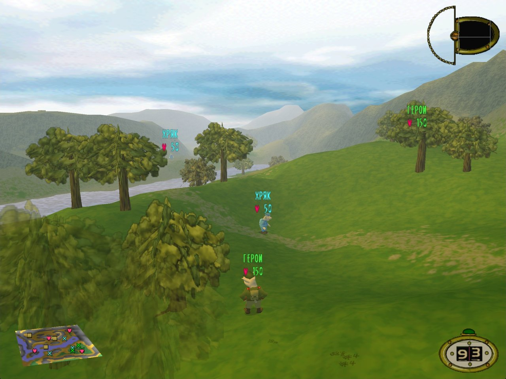
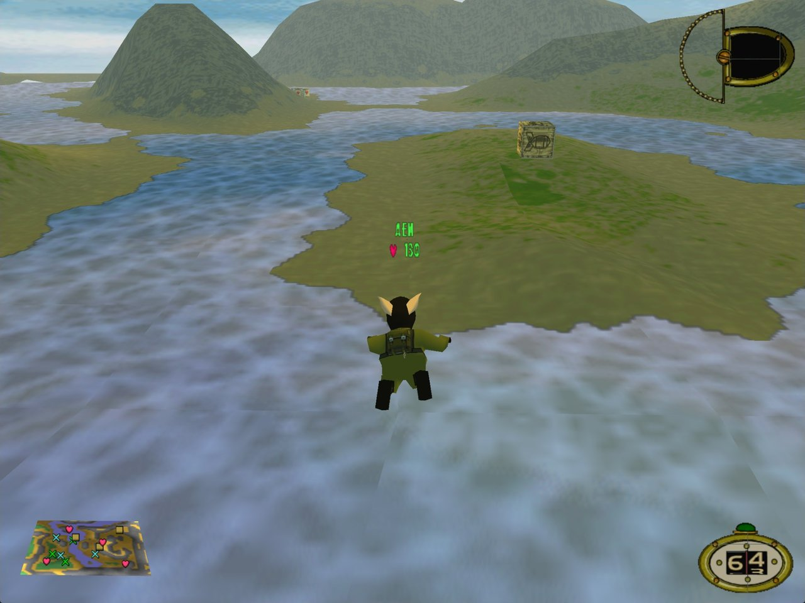
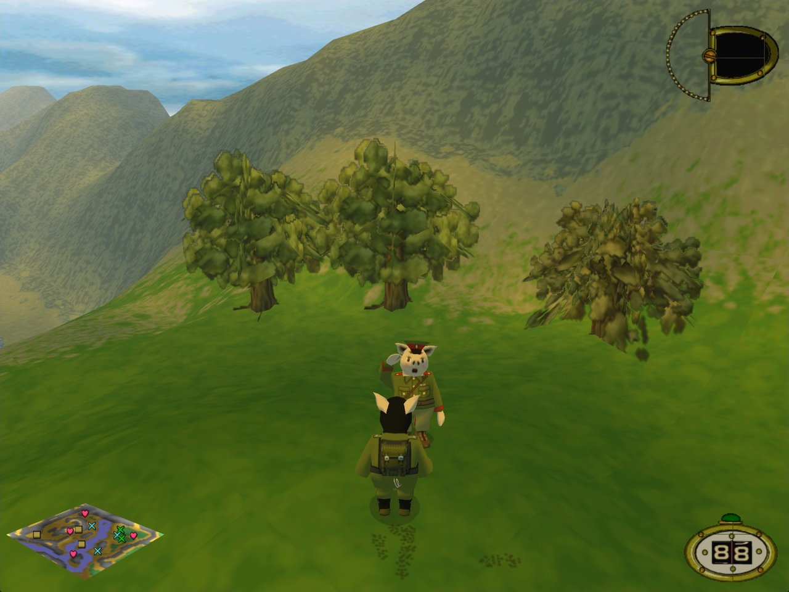
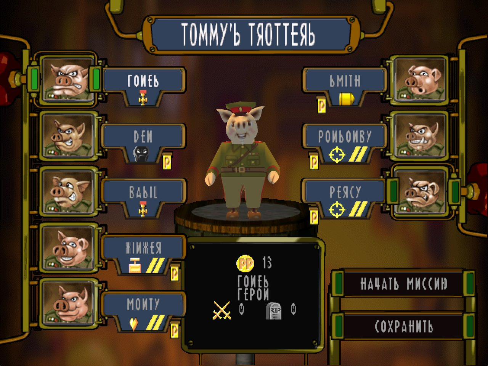

# Hogs of War Fix for Windows 10 and 11

**English** · [Русский](README.ru.md)

[](https://github.com/accidev/hogs-of-war-fix/actions/workflows/build.yml)
[](https://github.com/accidev/hogs-of-war-fix/releases/latest)

[Hogs of War](https://store.steampowered.com/app/389900/Hogs_of_War/) is a turn-based tactics game with pigs, made in 2000 by Gremlin Interactive and Infogrames. It is a PlayStation 1 classic that also came out on Windows. The Steam version of the Windows game does not start on Windows 10 and 11, and while it runs, it disables every other window on the desktop. This fan fix makes the game start and play well: in a big window or borderless fullscreen, on a new Direct3D 11 renderer, with smooth motion, wide-screen battles, music, camera zoom and Xbox controller support.

[](https://github.com/accidev/hogs-of-war-fix/releases/latest/download/HogsFix.zip)
[](https://youtu.be/oBo27HB4x_4)

<p align="center">
  
</p>
<p align="center">
  
  
  
</p>

## What you get

- **The game starts.** Its CD music library hung the Windows 10/11 DLL loader, so the game window never opened. A current build of ogg-winmm replaces it. The game also starts when its Windows registry entry is missing, for example from a game folder copied from another PC.
- **The desktop keeps working.** The original disabled all other windows until you quit through its menu, so after Alt+Tab or a crash the desktop stayed dead. Now the game leaves other windows alone.
- **A new renderer.** The game's DirectDraw 7 and Direct3D 7 calls run on Direct3D 11. There is no display mode switch, transparency is correct and the ground no longer vanishes in stripes. Each frame is rendered at a multiple of the game resolution and scaled down to the window, so edges are smooth.
- **Smooth battles.** The game draws as many frames per second as your monitor shows instead of 25, and still runs at its original speed. It no longer loads one CPU core to 100 %. `[Battle] FrameRate` sets the number of frames. This was checked by measurement; how it looks on 60 and 144 Hz monitors has not been checked by players yet.
- **A big window or borderless fullscreen.** The window opens as large as the screen allows and takes the shape of the game resolution, 4:3 or wide. You can resize or maximize it, and Alt+Tab is safe.
- **More resolutions:** 1280×960, 1600×1200 and 1920×1440, in addition to the original 640×480 to 1024×768.
- **Wide-screen battles.** If your monitor is wider than 4:3, the game also offers resolutions in the shape of the monitor (16:9, 16:10, 21:9). A battle in one fills the screen and shows more to the sides instead of stretching the picture. Menus and videos stay 4:3, with black bars. A new player starts in a wide resolution automatically. If you update, your saved resolution stays: hold Shift while the game starts to pick a wide one. Wide screen is new: it was tested on 16:9 and on a simulated 21:9, so please report problems on other monitors.
- **Computer pigs walk.** In the original PC game they stayed where they were on their turn, because their path finder never ran. Now they walk, at the same speed as your pigs (`[Battle] ComputerWalks`). This was checked in three computer turns; a whole campaign mission with walking computer pigs has not been played through yet.
- **Camera zoom** with the mouse wheel or Numpad + and −.
- **A usable gamepad.** Xbox controllers (XInput) work without setup, with the button layout of the PlayStation version (see Controls). The stick dead zone of other joysticks is 15 % instead of 50 %. The Xbox support is new and has been tested only with a simulated controller, not a real one, so please tell us how it works for you.
- **Straight to the title screen.** There is no resolution dialog and no intro videos. You can turn both back on.
- **Menus at their original speed.** Their animations were tied to the frame rate and raced on a fast renderer. The game also no longer freezes after its window was minimized.
- **Music** from `MUSIC\TrackNN.ogg`. The in-game music volume no longer changes the game's volume in the Windows mixer.

## Install

You need Hogs of War from Steam (version 1.2) on Windows 10 or 11.

1. Download **[HogsFix.zip](https://github.com/accidev/hogs-of-war-fix/releases/latest/download/HogsFix.zip)**.
2. Open the game folder: in Steam, right-click Hogs of War → **Manage** → **Browse local files**.
3. Extract the zip into that folder. A `HogsFix` folder appears next to `warhogs_.exe`.
4. Open `HogsFix` and double-click **`patch.cmd`**. Wait until it says **Done**.
5. Start the game from Steam as usual.

The [install video](https://youtu.be/oBo27HB4x_4) shows all of this on a fresh copy of the game from Steam.

Good to know:

- Windows can warn you that `patch.cmd` came from the internet. Choose **Run**, or **More info** → **Run anyway**.
- The patcher checks everything before it changes anything. It keeps the original files as `warhogs_.exe.orig` and `winmm.dll.orig`.
- **Update:** extract the new zip over the old `HogsFix` folder and run `patch.cmd` again. Your settings in `hogs.ini` are kept, and the settings that are new in the version are added to it with their descriptions. The resolution you chose earlier stays too: to play in a wide one, hold Shift while the game starts and choose it.
- **Uninstall:** double-click `HogsFix\uninstall.cmd`. It puts the original files back and removes the fix with its settings.

## Controls

| Key | Action |
|---|---|
| Mouse wheel, Numpad + and − | Camera closer or farther, 50 to 200 % |
| Shift, held while the game starts | Resolution and detail dialog. Here you pick a wide resolution after an update |
| F11 | 10 promotion points, if the cheat is on (see below) |

An Xbox (XInput) controller works without setup. Its buttons sit where the buttons of the PlayStation version were, and in a battle each button presses the key that is set for it in Options → Controls.

| Controller | Action |
|---|---|
| D-pad or left stick | Move, aim, menus |
| A (cross) | Fire, select |
| B (circle) | Weapon menu, back |
| X (square) | Jump |
| Y (triangle) | Enter and leave vehicles, back |
| LB (L1), held | Look-around camera and fine aim |
| RB or right stick up | Aim higher, switch to another pig |
| RT or right stick down | Aim lower, switch to another pig |
| Start | Pause |
| Back | The Select button of the PlayStation version |

In menus A or Start selects and B or Y goes back. On the results screen A continues and Y retries. A, B or Start skip a video.

## Settings

The settings are in `hogs.ini` in the game folder. Restart the game after you change them.

| Setting | Default | What it does |
|---|---|---|
| `[Display] Windowed` | `1` | 1 = window. 0 = the original fullscreen mode, which the new renderer does not support |
| `[Display] Resizable` | `1` | The window can be resized and maximized |
| `[Display] Borderless` | `0` | 1 = a borderless window over the whole monitor, like fullscreen |
| `[Display] Widescreen` | `1` | 1 = the launcher also offers resolutions in the shape of your monitor (16:9, 21:9...). A battle in one fills the screen and shows more to the sides. Menus and videos stay 4:3, with black bars. 0 = 4:3 resolutions only |
| `[Startup] SkipLauncher` | `1` | Start with the resolution chosen last time. The first start takes the smallest one for your monitor, which has the largest interface. Hold Shift at start to choose again |
| `[Startup] SkipIntro` | `1` | No logos and intro videos at start |
| `[Battle] FrameRate` | `0` | Frames per second in a battle. 0 = as many as the monitor shows (60, 144...), 25 or less = as the original game, a higher number = that many (no more than the monitor shows while `VSync=1`). The game speed does not change |
| `[Battle] Interpolation` | `1` | 0 = the frames between two game steps repeat the last step instead of showing the motion between them, to find the cause of a glitch |
| `[Battle] ComputerWalks` | `1` | 1 = computer pigs walk on their turn. 0 = they stay where they are, as in the original PC game |
| `[Gamepad] XInput` | `1` | 1 = Xbox controllers work without setup. 0 = the game's own joystick support handles them, as before |
| `[Gamepad] XInputDeadzone` | `30` | How far the left stick of such a controller must be pushed to count, in percent |
| `[Gamepad] Deadzone` | `15` | Dead zone of other joysticks, set up in Options → Controls, in percent of the stick travel. The original game used 50 |
| `[Render] Scale` | `0` | Render at game resolution × Scale. 0 = enough to cover the monitor |
| `[Render] VSync` | `1` | Wait for the monitor refresh |
| `[Render] FogDistance` | `100` | How far the fog is, in percent of the original distance. 200 = you see twice as far. At large values the edge of the map can show |

The interface is drawn in pixels, so it gets smaller at the high resolutions. More lines make the interface smaller, not the picture sharper.

**Cheat.** Add these lines to `hogs.ini`. Then F11 gives the team on screen 10 promotion points (PP), up to 999.

```ini
[Cheats]
PromotionPoints=1
```

## Troubleshooting

- **No music or sound.** Open the Windows volume mixer and raise Hogs of War. The original game changed its own volume there together with the music volume, and it could leave it at 0. The fix stops this, but a 0 that was saved earlier stays.
- **Black bars at the sides, or no wide resolution in the list.** Menus and videos are always 4:3. For a battle, hold Shift while the game starts and choose a wide resolution; after an update the game keeps the one you chose earlier. Wide resolutions appear only if your monitor is wider than 4:3 and `[Display] Widescreen` is 1. The list stops at 4096 pixels wide.
- **The controller does not react.** Xbox controllers need no setup (`[Gamepad] XInput` is 1). Other joysticks are set up in Options → Controls. The Xbox support is new, so if yours does not work, open an [issue](https://github.com/accidev/hogs-of-war-fix/issues) and say which controller it is.
- **"Unknown warhogs_.exe".** Only the Steam version 1.2 is supported. If another tool changed the exe, verify the game files in Steam (Properties → Installed Files → Verify integrity of game files) and run `patch.cmd` again.
- **"Hogs of War is running".** Close the game, then run `patch.cmd` again.
- **The game does not start after you added dgVoodoo2 or another `ddraw.dll`.** The fixed game needs the `ddraw.dll` of this fix: it holds the fixes and the renderer. Run `patch.cmd` again; it keeps the other files as `*.orig`.
- **The game does not start or crashes.** Open an [issue](https://github.com/accidev/hogs-of-war-fix/issues) and attach `hogs.log` and `hogsdraw.log` from the game folder.

## How it works

| File in the game folder | Role |
|---|---|
| `warhogs_.exe` | Patched by `patch.cmd`. 325 calls that went through the LaserLock copy protection (`wh32lib.dll`) now call Windows directly, and the game loads the fixes from `ddraw.dll` in its place |
| `ddraw.dll` | The fixes and the renderer. The fixes are applied in memory when the game starts: windows, start-up, the battle loop with its frames, computer pigs, wide screen, menu speed, gamepad, camera, music volume, the lookup of the game's registry entry and the game's renderer `_d3d.dll`. Each fix checks the original bytes first. Log: `hogs.log`. The renderer, hogsdraw, is the game's DirectDraw 7 and Direct3D 7 on Direct3D 11. Log: `hogsdraw.log` |
| `winmm.dll`, `winmm.ini` | [ogg-winmm](https://github.com/ayuanx/ogg-winmm) by ayuanx (GPL-2.0): CD music from OGG files |
| `hogs.ini` | Settings |

This repository contains no game files. The patcher changes your own copy of the game.

## Building from source

You need Visual Studio 2022 or later with C++, CMake and PowerShell 7.

```powershell
pwsh tools/make_release.ps1    # builds dist/HogsFix and dist/HogsFix.zip
```

GitHub Actions builds the same zip on every push to `main` and every pull request, and a `v*` tag publishes it as a release. Developer notes are in [docs/DEVELOPMENT.md](docs/DEVELOPMENT.md). The technical log and the renderer analysis are in Russian: [docs/WORKLOG.md](docs/WORKLOG.md), [docs/renderer/](docs/renderer/).

## Roadmap

- A wider camera view angle. It is not done: the game's ground and models use different camera settings, so it is more work than it looks.
- Long term: decompile the game and build it as a native 64-bit program.

What changed in each version is in [CHANGELOG.md](CHANGELOG.md). The task list is in [docs/TODO.md](docs/TODO.md) (in Russian).

## Credits and license

- The code of this fix is under the [MIT license](LICENSE).
- [ogg-winmm](https://github.com/ayuanx/ogg-winmm) by ayuanx plays the CD music. It is under GPL-2.0, and the release package includes its license.
- Hogs of War and its screenshots belong to the game's rights holders. This is an unofficial fan project.
