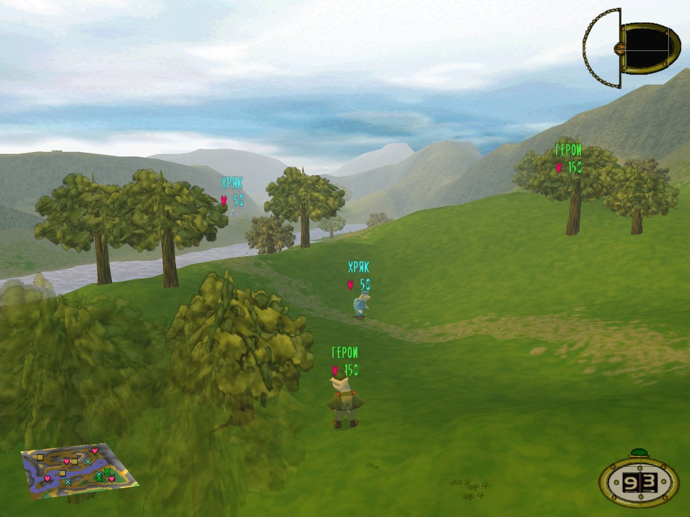
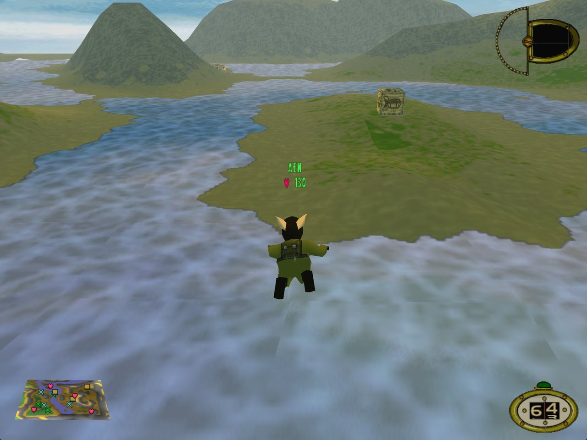
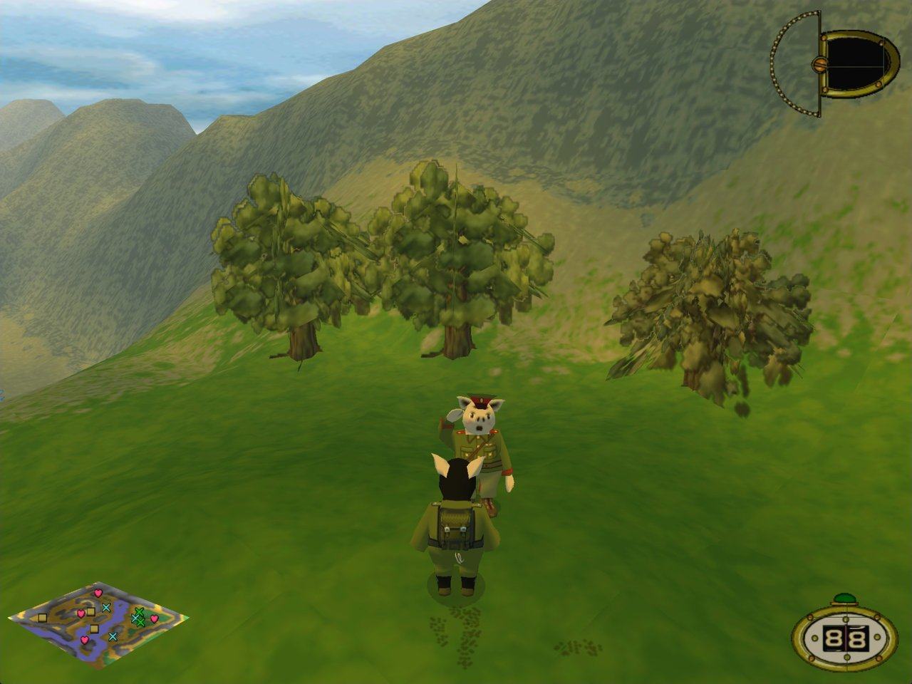
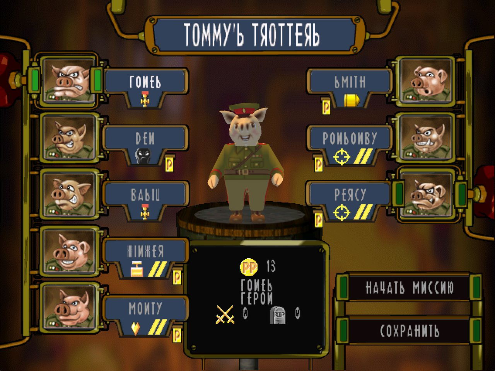

# Hogs of War: исправление для Windows 10 и 11

[English](README.md) · **Русский**

[](https://github.com/accidev/hogs-of-war-fix/actions/workflows/build.yml)
[](https://github.com/accidev/hogs-of-war-fix/releases/latest)

[Hogs of War](https://store.steampowered.com/app/389900/Hogs_of_War/) («Свиньи войны») — пошаговая тактика про свиней, которую в 2000 году сделали Gremlin Interactive и Infogrames. Это классика PlayStation 1, игра выходила и на Windows. Steam-версия для Windows не запускается на Windows 10 и 11, а пока работает, выключает все остальные окна рабочего стола. Это фанатское исправление возвращает игру к жизни: большое окно или полный экран без рамки, новый рендер на Direct3D 11, плавная картинка, бои на широком экране, музыка, отдаление камеры и геймпад Xbox.

[](https://github.com/accidev/hogs-of-war-fix/releases/latest/download/HogsFix.zip)
[](https://youtu.be/oBo27HB4x_4)

<p align="center">
  
</p>
<p align="center">
  
  
  
</p>

## Что исправлено

- **Игра запускается.** Её библиотека CD-музыки вешала загрузчик DLL Windows 10/11, и окно игры так и не появлялось. Её заменяет свежая сборка ogg-winmm. Игра запускается и без своей записи в реестре Windows, например из папки, скопированной с другого компьютера.
- **Рабочий стол не блокируется.** Оригинал выключал все остальные окна до выхода через своё меню, поэтому после Alt+Tab или падения рабочий стол «умирал». Теперь игра чужие окна не трогает.
- **Новый рендер.** Вызовы DirectDraw 7 и Direct3D 7 игры работают на Direct3D 11. Видеорежим не переключается, прозрачность правильная, земля больше не пропадает полосами. Кадр рисуется в разрешении, кратном игровому, и уменьшается под окно, поэтому края гладкие.
- **Плавный бой.** Игра рисует столько кадров в секунду, сколько показывает монитор, а не 25, и идёт с прежней скоростью. Одно ядро процессора больше не загружено на 100 %. Число кадров задаёт `[Battle] FrameRate`. Это проверено измерениями; как это выглядит на мониторах 60 и 144 Гц, игроки ещё не проверяли.
- **Большое окно или полный экран без рамки.** Окно открывается такого размера, какой позволяет экран, и принимает форму игрового разрешения: 4:3 или широкую. Его можно растянуть или развернуть, Alt+Tab безопасен.
- **Больше разрешений:** 1280×960, 1600×1200 и 1920×1440 в добавление к родным 640×480 … 1024×768.
- **Бои на широком экране.** Если монитор шире 4:3, бои идут в разрешении его формы (16:9, 16:10, 21:9): картинка занимает весь экран и показывает больше по бокам, а не растягивается. Меню и ролики остаются 4:3 с чёрными полосами. Игра запускается в самом большом таком разрешении. Зажмите Shift при запуске, чтобы выбрать меньшее: чем меньше строк, тем крупнее интерфейс, а чёткость картинки та же. Широкий экран проверяли на 16:9 и на имитации 21:9, поэтому о проблемах на других мониторах, пожалуйста, сообщайте.
- **Свиньи компьютера ходят.** В оригинальной PC-версии они на своём ходу стояли на месте, потому что их поиск пути не работал. Теперь они идут, с той же скоростью, что и ваши свиньи (`[Battle] ComputerWalks`). Это проверено на трёх ходах компьютера; целую миссию кампании с ходящими свиньями компьютера пока никто не проходил.
- **Отдаление камеры** колесом мыши или клавишами Num+ и Num−.
- **Нормальный геймпад.** Геймпады Xbox (XInput) работают без настройки, кнопки расположены как в версии для PlayStation (см. «Управление»). Мёртвая зона стика у остальных джойстиков 15 % вместо 50 %. Поддержка Xbox новая и проверялась только на имитации геймпада, не на настоящем, поэтому расскажите, как она работает у вас.
- **Сразу к титульному экрану.** Нет окна выбора разрешения и вступительных роликов. Оба можно вернуть.
- **Меню на родной скорости.** Их анимация привязана к частоте кадров и на быстром рендере мчалась. Игра также больше не замирает после сворачивания окна.
- **Музыка** из `MUSIC\TrackNN.ogg`. Громкость музыки в игре больше не меняет громкость игры в микшере Windows.

## Установка

Нужна Hogs of War из Steam (версия 1.2) на Windows 10 или 11.

1. Скачайте **[HogsFix.zip](https://github.com/accidev/hogs-of-war-fix/releases/latest/download/HogsFix.zip)**.
2. Откройте папку игры: в Steam правой кнопкой по Hogs of War → **Управление** → **Просмотреть локальные файлы**.
3. Распакуйте архив в эту папку. Рядом с `warhogs_.exe` появится папка `HogsFix`.
4. Откройте `HogsFix` и дважды щёлкните **`patch.cmd`**. Дождитесь надписи **Done**.
5. Запускайте игру из Steam как обычно.

Всё это на свежей копии игры из Steam показано в [видео установки](https://youtu.be/oBo27HB4x_4).

Полезно знать:

- Windows может предупредить, что `patch.cmd` скачан из интернета. Выберите **Выполнить** или **Подробнее** → **Выполнить в любом случае**.
- Патчер всё проверяет до первого изменения. Оригинальные файлы он сохраняет как `warhogs_.exe.orig` и `winmm.dll.orig`.
- **Обновление:** распакуйте новый архив поверх старой папки `HogsFix` и снова запустите `patch.cmd`. Ваши настройки в `hogs.ini` сохранятся, а новые настройки версии дописываются в него вместе с описаниями.- **Удаление:** дважды щёлкните `HogsFix\uninstall.cmd`. Он вернёт оригинальные файлы и удалит исправление вместе с настройками.

## Управление

| Клавиша | Действие |
|---|---|
| Колесо мыши, Num+ и Num− | Камера ближе или дальше, от 50 до 200 % |
| Shift, зажатый при запуске игры | Окно выбора разрешения и детализации. Чем меньше строк, тем крупнее интерфейс |
| F11 | 10 очков повышения, если включён чит (см. ниже) |

Геймпад Xbox (XInput) работает без настройки. Его кнопки стоят там же, где были кнопки в версии для PlayStation, а в бою каждая нажимает клавишу, назначенную ей в «Настройки → Управление».

| Геймпад | Действие |
|---|---|
| Крестовина или левый стик | Движение, прицел, меню |
| A (крестик) | Выстрел, выбор |
| B (кружок) | Меню оружия, назад |
| X (квадрат) | Прыжок |
| Y (треугольник) | Сесть в транспорт и выйти из него, назад |
| LB (L1), удерживать | Камера осмотра и точный прицел |
| RB или правый стик вверх | Прицел выше, смена свиньи |
| RT или правый стик вниз | Прицел ниже, смена свиньи |
| Start | Пауза |
| Back | Кнопка Select версии для PlayStation |

В меню A или Start выбирают, B или Y возвращают назад. На экране итогов A продолжает, Y начинает бой заново. A, B или Start пропускают ролик.

## Настройки

Настройки лежат в `hogs.ini` в папке игры. После изменения перезапустите игру.

| Параметр | По умолчанию | Что делает |
|---|---|---|
| `[Display] Borderless` | `0` | 1 = полный экран: окно без рамки на весь монитор. 0 = окно с рамкой |
| `[Display] Resizable` | `1` | Окно с рамкой можно растягивать и разворачивать |
| `[Display] Widescreen` | `1` | 1 = на мониторе шире 4:3 бои идут в разрешении его формы (16:9, 21:9…): занимают весь экран и показывают больше по бокам. Меню и ролики остаются 4:3 с чёрными полосами. 0 = только разрешения 4:3 |
| `[Startup] SkipLauncher` | `1` | Запуск с разрешением, выбранным в прошлый раз. При первом запуске берётся самое большое для вашего монитора. Зажмите Shift при запуске, чтобы выбрать заново: чем меньше строк, тем крупнее интерфейс |
| `[Startup] SkipIntro` | `1` | Без логотипов и вступительных роликов |
| `[Battle] FrameRate` | `0` | Кадров в секунду в бою. 0 = столько, сколько показывает монитор (60, 144…), 25 и меньше = как в оригинале, число больше = столько (но не больше, чем показывает монитор, пока `VSync=1`). Скорость игры не меняется |
| `[Battle] Interpolation` | `1` | 0 = кадры между двумя шагами игры повторяют прошлый шаг, а не показывают движение между ними (чтобы найти причину сбоя) |
| `[Battle] ComputerWalks` | `1` | 1 = свиньи компьютера ходят на своём ходу. 0 = стоят на месте, как в оригинальной PC-версии |
| `[Gamepad] XInput` | `1` | 1 = геймпады Xbox работают без настройки. 0 = ими занимается собственная поддержка джойстиков игры, как раньше |
| `[Gamepad] XInputDeadzone` | `30` | На сколько процентов нужно отклонить левый стик такого геймпада, чтобы это засчиталось |
| `[Gamepad] Deadzone` | `15` | Мёртвая зона остальных джойстиков (они настраиваются в «Настройки → Управление») в процентах хода стика. В оригинале было 50 |
| `[Render] Scale` | `0` | Рисовать в разрешении игры × Scale. 0 = столько, чтобы покрыть монитор |
| `[Render] VSync` | `1` | Ждать обновления монитора |
| `[Render] FogDistance` | `100` | Как далеко туман, в процентах от исходной дальности. 200 = видно вдвое дальше. При больших значениях может показаться край карты |

Интерфейс игры нарисован в пикселях, поэтому на больших разрешениях он мельче. Больше строк делает интерфейс мельче, а не картинку чётче.

**Чит.** Добавьте в `hogs.ini` эти строки. Тогда F11 даёт команде на экране 10 очков повышения (PP), не больше 999.

```ini
[Cheats]
PromotionPoints=1
```

## Если что-то не так

- **Нет музыки или звука.** Откройте микшер громкости Windows и поднимите Hogs of War. Оригинальная игра меняла там свою громкость вместе с громкостью музыки и могла оставить 0. Исправление это прекращает, но сохранённый раньше 0 остаётся.
- **Чёрные полосы по бокам.** Меню и ролики всегда 4:3. Бои широкие, только если монитор шире 4:3 и `[Display] Widescreen` равен 1. Разрешение может быть не больше 4096 точек в ширину и 1536 строк в высоту.
- **Интерфейс и имена над свиньями слишком мелкие.** Они рисуются в пикселях игры: чем меньше строк, тем они крупнее, а чёткость картинки та же. Зажмите Shift при запуске игры и выберите разрешение поменьше, например 1280×720.
- **Геймпад не реагирует.** Геймпадам Xbox настройка не нужна (`[Gamepad] XInput` равен 1). Остальные джойстики настраиваются в «Настройки → Управление». Поддержка Xbox новая, поэтому, если ваш геймпад не работает, создайте [issue](https://github.com/accidev/hogs-of-war-fix/issues) и напишите, какой это геймпад.
- **«Unknown warhogs_.exe».** Поддерживается только Steam-версия 1.2. Если exe изменила другая программа, проверьте файлы игры в Steam (Свойства → Установленные файлы → Проверить целостность файлов игры) и снова запустите `patch.cmd`.
- **«Hogs of War is running».** Закройте игру и снова запустите `patch.cmd`.
- **Игра не запускается после установки dgVoodoo2 или другого `ddraw.dll`.** Исправленной игре нужен `ddraw.dll` из этого исправления: в нём исправления и рендер. Снова запустите `patch.cmd`; чужие файлы он сохранит как `*.orig`.
- **Игра не запускается или падает.** Создайте [issue](https://github.com/accidev/hogs-of-war-fix/issues) и приложите `hogs.log` и `hogsdraw.log` из папки игры.

## Как это устроено

| Файл в папке игры | Роль |
|---|---|
| `warhogs_.exe` | Его меняет `patch.cmd`. 325 вызовов, которые шли через защиту LaserLock (`wh32lib.dll`), теперь вызывают Windows напрямую, а вместо `wh32lib.dll` игра загружает исправления из `ddraw.dll` |
| `ddraw.dll` | Исправления и рендер. Исправления применяются в памяти при запуске игры: окна, запуск, цикл боя с его кадрами, свиньи компьютера, широкий экран, скорость меню, геймпад, камера, громкость музыки, поиск записи игры в реестре и рендер игры `_d3d.dll`. Каждое исправление сначала сверяет исходные байты. Журнал: `hogs.log`. Рендер hogsdraw — это DirectDraw 7 и Direct3D 7 игры на Direct3D 11. Журнал: `hogsdraw.log` |
| `winmm.dll`, `winmm.ini` | [ogg-winmm](https://github.com/ayuanx/ogg-winmm) от ayuanx (GPL-2.0): CD-музыка из файлов OGG |
| `hogs.ini` | Настройки |

В репозитории нет файлов игры. Патчер меняет вашу собственную копию игры.

## Сборка из исходников

Нужны Visual Studio 2022 или новее с C++, CMake и PowerShell 7.

```powershell
pwsh tools/make_release.ps1    # собирает dist/HogsFix и dist/HogsFix.zip
```

GitHub Actions собирает такой же архив на каждый push в `main` и на каждый pull request, а тег `v*` публикует его как релиз. Заметки для разработчиков (на английском): [docs/DEVELOPMENT.md](docs/DEVELOPMENT.md). Технический журнал и разбор рендера: [docs/WORKLOG.md](docs/WORKLOG.md), [docs/renderer/](docs/renderer/).

## Планы

- Более широкий угол обзора камеры. Он не сделан: у земли и моделей игры разные настройки камеры, так что работы больше, чем кажется.
- Большая цель: декомпилировать игру и собрать её как родную 64-битную программу.

Изменения по версиям (на английском): [CHANGELOG.md](CHANGELOG.md). Список задач: [docs/TODO.md](docs/TODO.md).

## Благодарности и лицензия

- Код исправления распространяется по [лицензии MIT](LICENSE).
- [ogg-winmm](https://github.com/ayuanx/ogg-winmm) от ayuanx играет CD-музыку. Он под GPL-2.0, его лицензия лежит в релизном архиве.
- Права на Hogs of War и её скриншоты принадлежат правообладателям игры. Это неофициальный фанатский проект.
